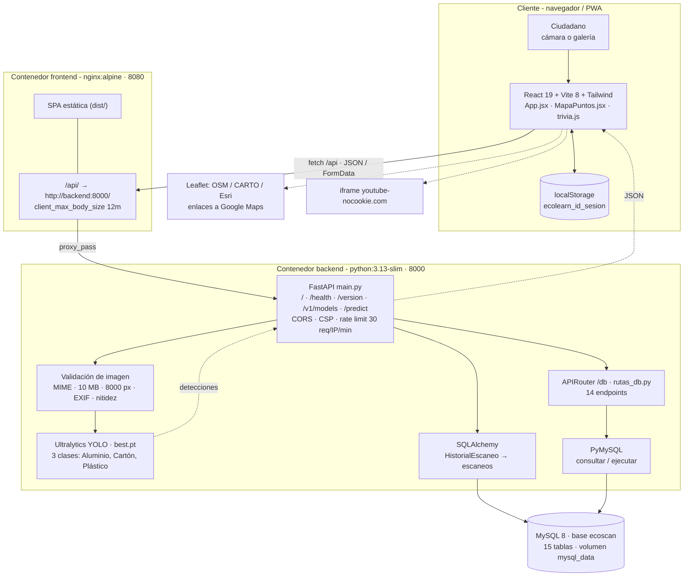

# EcoLearn Chile — Clasificador Inteligente de Residuos (EcoScan)

Proyecto Capstone. El usuario sube una foto de un residuo, un modelo **YOLO11n**
detecta el material (**Aluminio, Cartón, Plástico**), el backend responde con
instrucciones de reciclaje y guarda el análisis en **MySQL 8**. La app además
ofrece puntos limpios de la Región Metropolitana, un simulador educativo y un
desafío verde.

- **Backend:** FastAPI + Ultralytics (YOLO11n, `best.pt`) + MySQL.
- **Frontend:** React 19 + Vite + Tailwind (PWA, Menú Principal + 4 módulos; impacto integrado en el simulador).
- **Despliegue:** Docker Compose (MySQL + backend + frontend Nginx).
- **Calidad:** pytest, Vitest, Cypress, oxlint, GitHub Actions.

> **Documentación vigente (20-11-2026):** el alcance canónico, los nombres de
> módulos y la deuda conocida están en
> [`docs/DOCUMENTACION_GENERAL.md`](docs/DOCUMENTACION_GENERAL.md). El contraste
> de los 161 issues de Jira contra este código está en
> [`docs/AUDITORIA_JIRA.md`](docs/AUDITORIA_JIRA.md).

## Arquitectura

> Auditoría completa, diagrama de secuencia y evidencia por archivo:
> [`docs/ARQUITECTURA.md`](docs/ARQUITECTURA.md). Este bloque sustituye al
> diagrama ASCII anterior y al PNG histórico `Fase 2/Evidencia/Arquitectura_EcoLearn.png`.



El frontend consume la API en `VITE_API_URL` (por defecto `/api`, mismo origen;
`nginx.conf:9-16` redirige a `backend:8000`). Así la app funciona también cuando
se comparte por un túnel, sin depender del `127.0.0.1` del visitante. No hay
cuentas ni login: la sesión es un UUID anónimo en `localStorage`.

## Estructura de la carpeta `Fase 3`

Todo el proyecto está agrupado aquí. Todos los comandos de esta guía se ejecutan
**desde `Fase 3/`**. En VS Code abre esa carpeta para que `.vscode/` aplique.

| Ruta | Contenido |
|---|---|
| `ecoscan-backend/` | API FastAPI (`main.py`), rutas de datos (`rutas_db.py`), `best.pt`, `Dockerfile`, pruebas (`tests/`) |
| `ecoscan-frontend/` | App React + Vite + Tailwind (Menú Principal + 4 módulos: Escáner IA, Puntos Limpios RM —mapa Leaflet/OpenStreetMap, 35 registros, 10 propios y 25 externos sin validar, procedencia y coordenada aproximada visibles—, Eco-Simulador RM —galería de consejos y videos, impacto automático, sin sliders ni escenarios— y Desafío Verde RM), `Dockerfile`, Cypress y Vitest |
| `docker/mysql/init/` | `01_schema.sql` (esquema `ecoscan`) y `02_seed.sql` (datos iniciales) |
| `docker-compose.yml` | Stack completo: MySQL 8.0 (host 3307), backend (8000), frontend Nginx (5173) con *healthchecks* |
| `scripts/` | `run.ps1` / `run.sh` / `run.bat` (arranque reproducible), `verificar_docker.ps1`, `instalar_docker.ps1`, `init_local_db.py` |
| `docs/` | CRISP-DM, requisitos (100 RF/RNF), BPMN, modelo de datos, informe de pruebas |
| `../Fase 1/`, `../Fase 2/` | Entregables originales en la raíz del repo; se elevaron sin borrar el historial |
| `.github/workflows/ci.yml` (en la raíz del repo) | CI: pytest + cobertura + pip-audit; frontend: `build` → `test:unit` → `npm audit` (PR 1) |
| `.env.example` | Variables de entorno (copiar a `.env`) |

## Puesta en marcha

### Opción A — Docker (recomendada)

Requisitos: Docker Desktop con WSL2 (en Windows, `scripts/instalar_docker.ps1`
lo instala si falta).

```bash
cp .env.example .env             # Windows: copy .env.example .env
# Editar .env y definir MYSQL_ROOT_PASSWORD (y MYSQL_PASSWORD) con una clave propia
docker compose up --build -d     # MySQL 3307, backend 8000, frontend 5173
docker compose ps                # los 3 servicios deben verse "healthy"
```

> El compose no usa valores por defecto para la contraseña: si
> `MYSQL_ROOT_PASSWORD` no está definida en `.env`, `docker compose up` falla
> con el mensaje `Definir MYSQL_ROOT_PASSWORD en .env`.

- App: http://localhost:5173/
- API: http://127.0.0.1:8000/ · Docs: http://127.0.0.1:8000/docs

Atajos de arranque: `scripts\run.ps1 -Docker` (Windows) o `bash scripts/run.sh --docker`.
En VS Code: tarea **"EcoScan: DOCKER (compose up)"**. Para detener: `docker compose down`.

> El backend y el frontend locales (puertos 8000 y 5173) deben estar detenidos
> para que Docker use esos puertos.

### Opción B — Local

```bash
# 1) Variables de entorno
cp .env.example .env            # completar credenciales de MySQL

# 2) Base de datos (MySQL 8 local en 3306)
#    Crear la base `ecoscan` y ejecutar docker/mysql/init/01_schema.sql y 02_seed.sql

# 3) Backend
cd ecoscan-backend
python -m venv venv
venv\Scripts\activate           # Windows  (Linux/macOS: source venv/bin/activate)
pip install -r requirements.txt
python main.py                  # http://localhost:8000

# 4) Frontend
cd ../ecoscan-frontend
npm install
npm run dev                     # http://localhost:5173
```

## API principal

| Método | Ruta | Descripción |
|---|---|---|
| `POST` | `/predict` | Sube una imagen (`file`) y opcionalmente `id_sesion`; devuelve detecciones y conteo por material |
| `GET` | `/health` | Estado del servicio, conexión MySQL y modelo activo |
| `GET` | `/v1/models` | Modelo activo en formato tipo OpenAI |
| `GET` | `/db/puntos?comuna=...` | Puntos limpios filtrados por comuna |
| `GET` | `/db/*`, `/impacto`, `/sesiones` | Datos de materiales, hábitos, impacto y sesiones |

## Presentación final

[`docs/presentacion/EcoLearn_Presentacion_Final_Fase3.pptx`](docs/presentacion/)
(16 diapositivas): problema, solución, arquitectura, CRISP-DM, resultados,
capturas del demo, retrospectiva, gestión y trabajo futuro. Usa los nombres y
la tecnología reales de la app.

## CRISP-DM

Notebook completo: [`docs/crisp-dm/`](docs/crisp-dm/) (fases 1 a 6 y cierre).

| Fase | Estado |
|---|---|
| 1. Entendimiento del negocio | Hecho |
| 2. Entendimiento de los datos (EDA) | Hecho |
| 3. Preparación (485 etiquetas corregidas, +252 imágenes de aluminio por *oversampling*) | Hecho |
| 4. Modelado (YOLO11n, 50 épocas, transfer learning) | Hecho |
| 5. Evaluación | Hecho; criterio **mAP@50 = 0.65 no alcanzado** |
| 6. Despliegue | Backend + MySQL + frontend en Docker funcionando |

### Resultados (validación: 61 imágenes, 109 instancias)

| Iteración | Precisión | Recall | mAP@50 | mAP@50-95 |
|---|---|---|---|---|
| 1 — dataset sin limpiar | 0.798 | 0.561 | 0.638 | 0.357 |
| 2 — limpio + balanceo | 0.681 | 0.521 | 0.562 | 0.323 |

Por clase (iteración 2): Aluminio 0.493 · Cartón 0.737 · Plástico 0.454.
Pruebas de sistema con fotos reales: **27 de 30** correctas (métrica por foto,
no comparable con mAP). Latencia: modelo ~21 ms/imagen (GPU), API ~110 ms
promedio (P95 ~130 ms).

## Pruebas

```bash
# Backend (pytest + cobertura)
cd ecoscan-backend && venv\Scripts\python.exe -m pytest -q

# Frontend (Vitest)
cd ecoscan-frontend && npm run test:unit

# E2E (Cypress)
cd ecoscan-frontend && npm run test:e2e

# Pruebas de humo del modelo con fotos reales
cd ecoscan-backend && venv\Scripts\python.exe pruebas\probar_modelo.py
```

El pipeline de CI (`../.github/workflows/ci.yml`, en la raíz del repo) ejecuta
pytest con cobertura y `pip-audit` en el backend. En el frontend ejecuta
`npm run build`, luego `npm run test:unit` y después `npm audit`; ese orden fue
corregido en PR 1 (`092fc88`).

## Seguridad

Nunca subir claves al repositorio. Las credenciales de MySQL y los secretos van
en `.env` (ignorado por Git y por los `.dockerignore`); la API key de Roboflow
se inyecta por variable de entorno o en los Secretos de Colab. Ver `.env.example`.

Cuaderno de entrenamiento (Google Colab):
<https://colab.research.google.com/drive/1lK_ocnGYREm0CQUcNi4YHa4032lnwtAo>.
Revisado el 19-11-2026: se retiró una clave literal que aparecía en la celda de
entrenamiento y se corrigió la conclusión automática para exigir también
`mAP@50 ≥ 0.65` en `test`. La clave debe rotarse (REC-64 / REC-122); las salidas
guardadas del cuaderno difieren de la iteración final documentada (0.562) y no
deben usarse para afirmar que el objetivo se alcanzó. El detalle está en el
cuaderno de Colab y en `docs/crisp-dm/`; las salidas guardadas de la carpeta
`EVIDENCIA_ECOLEARN_ACTUALIZADA_2026-11-19/` no están versionadas en el repo.

Segunda iteración ejecutada el 19-11-2026 en la misma GPU T4 (YOLO11n, 100
épocas, `patience=20`): mAP@50 **0.622 en validación y 0.527 en test**, con
latencia PyTorch 12,9 ms y ONNX 129,6 ms. No supera la cifra oficial (0.562)
ni el objetivo (0.65), por lo que la tabla de resultados y la presentación
final se mantienen sin cambios. El registro está en el cuaderno de Colab; no
hay un archivo versionado con esa ruta dentro del repositorio.

## Equipo y gestión

Jira: tablero **EcoLearn** (proyecto **REC**). Ramas: `main` (estable), `develop`,
`feature/<ticket>`. Commits: `REC-xx: descripción corta`.

Repo público: <https://github.com/WiChanillao/Capstone_007>. En `main` están
tanto las evidencias de Fase 1 y Fase 2 (guías, diarios, PPT, CRISP-DM,
requisitos, BPMN, SQL e informe de pruebas), ahora en las carpetas `Fase 1/` y
`Fase 2/` de la raíz, como el código de la app, Docker Compose, CI y los
scripts. El historial original se integró sin borrarlo; el notebook de Fase 2
publicado usa variables de entorno para la API key de Roboflow.
