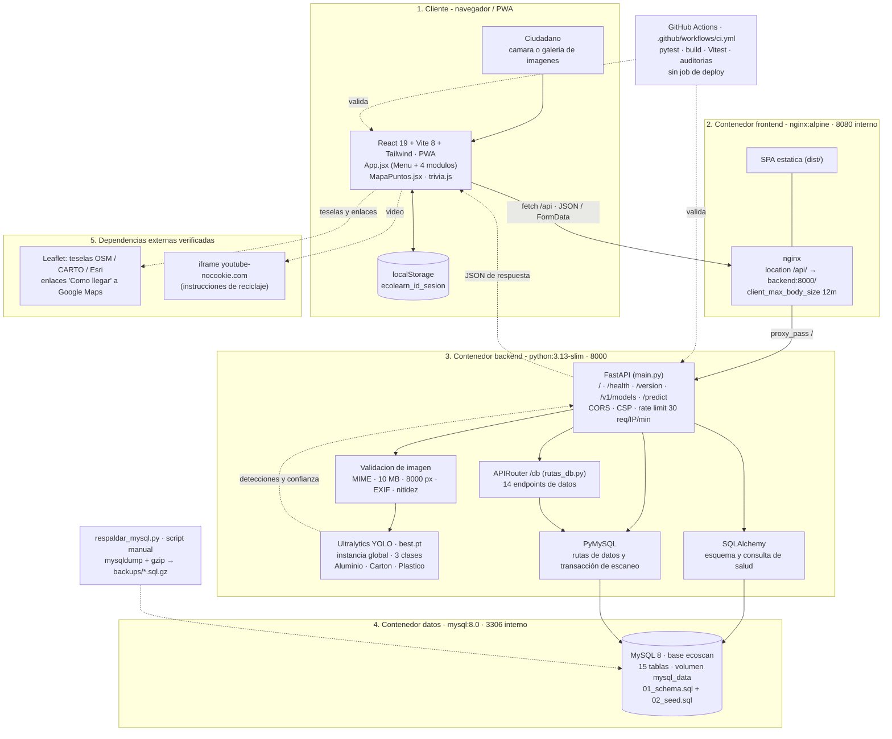
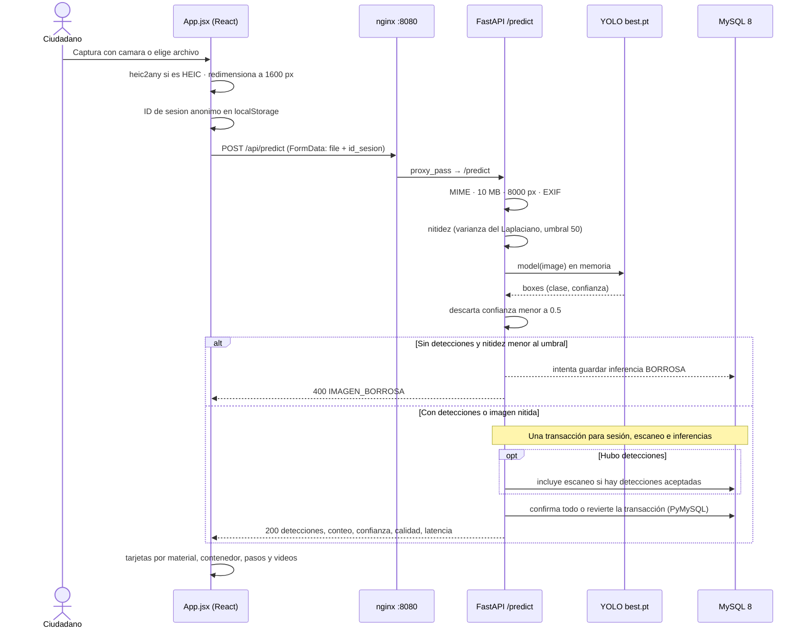

# Arquitectura real de EcoScan — EcoLearn Chile

> **Estado:** auditada contra el código en `main @ 0c8a7b3` (20-11-2026).
> **Archivo auditado:** `C:\Users\bruno diaz\Desktop\Fase 2\Fase 2\Evidencia\Arquitectura_EcoLearn.png`
> (254.902 bytes, SHA-256 `6CB2AD831C953DC3590187AE73D50834680B2E222E4D23C9588E0BC29CE95098`).
> Es **byte-idéntico** al `Fase 2/Evidencia/Arquitectura_EcoLearn.png` versionado,
> por lo que esta auditoría cubre ambas copias.
> Este documento es la **fuente canónica del diagrama**. Sustituye al diagrama
> histórico de `Fase 2/Evidencia/Arquitectura_EcoLearn.png` y a los bloques ASCII
> de `Fase 3/README.md` y `docs/DOCUMENTACION_GENERAL.md`.
> Sólo aparecen componentes verificados en el repositorio: no hay cajas fantasmas.

---

## 1. Diagrama de componentes y flujos

**Puertos publicados en Docker** (`docker-compose.yml:11,36,55`): MySQL
`127.0.0.1:3307`, backend `127.0.0.1:8000`, frontend `127.0.0.1:5173`.
Dentro de la red de Compose: `nginx → backend:8000` y `backend → mysql:3306`
(`BACKEND_MYSQL_HOST` se mapea a `MYSQL_HOST` en `docker-compose.yml:28`).

---

## 2. Flujo principal: de la foto a la clasificación

**En palabras:** el usuario captura o sube una imagen desde la SPA
(`App.jsx:617-673`, `826-854`). El frontend la convierte si es HEIC, la
redimensiona a 1600 px (`App.jsx:35-62`) y envía un `FormData` con el archivo y
un `id_sesion` anónimo guardado en `localStorage` (`App.jsx:492-510`) a
`/api/predict` (`App.jsx:732-744`). nginx, en el mismo contenedor frontend,
redirige `/api/` a `http://backend:8000/` (`nginx.conf:9-16`). FastAPI valida
formato, tamaño, dimensiones y rotación EXIF (`main.py:440-499`), calcula la
nitidez (`main.py:124-136,503`) y ejecuta la instancia global de YOLO sobre la
imagen en memoria (`main.py:345,506`) — **no se guarda ninguna imagen en disco**.
Las detecciones por debajo de `UMBRAL_CONFIANZA=0.5` se separan
(`main.py:523-529`); si no hay detecciones y la nitidez es menor a
`UMBRAL_NITIDEZ=50`, responde `400 IMAGEN_BORROSA` (`main.py:533-552`). En los
demás casos registra la inferencia en MySQL (`main.py:538-603`) y devuelve el
JSON con materiales detectados, estado de guardado, conteo por clase, confianza, calidad de imagen
y latencia (`main.py:610-622`). La UI muestra entonces tarjetas por material con
contenedor, pasos y videos (`App.jsx:1311-1472`).

Los catálogos de la app (materiales, puntos limpios, hábitos e impacto) siguen
otro camino: `fetch /api/db/...` → nginx → `rutas_db.py` → PyMySQL → MySQL
(`App.jsx:512-580`, `rutas_db.py:60-272`). Si falla, la UI usa respaldos
estáticos embebidos (`App.jsx:254-326,530-580`).

---

## 3. Auditoría del diagrama anterior

### 3.1 Lo que estaba bien representado

| Elemento | Diagrama anterior | Confirmación en código |
|---|---|---|
| Usuario → web → API → YOLO → MySQL | `Arquitectura_EcoLearn.png`; antes `README.md:22-30` | `App.jsx:13,732-744`; `main.py:40,345`; `docker-compose.yml:4-46` |
| React + Vite, PWA | antes `README.md:23` | `package.json:17-19,34`; `vite.config.js:8-37` |
| FastAPI + `/predict` | ambos diagramas | `main.py:40,418` |
| YOLO con `best.pt` | ambos diagramas | `main.py:332-345`; `ecoscan-backend/best.pt` (5,5 MB) |
| `/db/...`, `/health`, `/v1/models` | antes `README.md:27` | `rutas_db.py:18-330`; `main.py:373-415` |
| MySQL `ecoscan` con sesiones e inferencias | PNG Fase 2 | `01_schema.sql:133,297`; `main.py:247-258` |
| Nginx que redirige a `backend:8000` | antes `DOCUMENTACION_GENERAL.md:66-67` | `nginx.conf:9-16` |

### 3.2 Desactualizado, faltante o sobredimensionado

**Faltante en el PNG histórico y en el ASCII de `README.md`:**

- Los **3 contenedores** y su orden de arranque (`mysql` → `backend` →
  `frontend`) con healthchecks, `restart: unless-stopped` y volumen `mysql_data`
  (`docker-compose.yml:4-68`).
- El **proxy inverso** y el cambio de puerto: `/api/` se reescribe a
  `backend:8000` (`nginx.conf:9-16`); el backend **no** se expone como origen
  distinto para el navegador.
- El **rate limit** de 30 peticiones/minuto **sólo** para `/predict`
  (`main.py:43,139-159`), CORS con orígenes explícitos (`main.py:205-222`) y
  cabeceras CSP (`main.py:161-184`).
- El **`id_sesion` anónimo** en `localStorage`, sin cuentas ni login
  (`App.jsx:492-510`).
- Las **dos capas de acceso a la misma BD**: SQLAlchemy/ORM para esquema y consulta de salud
  (`main.py:242-261`) y PyMySQL directo para los 14 endpoints `/db/*`
  (`rutas_db.py:24-56`).
- La **validación completa de imagen** (10 MB, 8000 px, HEIC, EXIF, nitidez)
  y el hecho de que la imagen **nunca se persiste** (`main.py:440-499`).
- Las **15 tablas** reales del esquema (`01_schema.sql`), no 14.
- Dependencias externas reales: teselas Leaflet OSM/CARTO/Esri
  (`MapaPuntos.jsx:8-31`), enlaces a Google Maps (`App.jsx:346-353`) e iframe de
  YouTube (`App.jsx:2077`), y conversión HEIC con `heic2any` (`App.jsx:811-824`).
- CI que **valida pero no despliega** (`.github/workflows/ci.yml`).
- El script de backup manual `respaldar_mysql.py` y los `backups/*.sql.gz`.

**Sobredimensionado / desactualizado en documentación histórica:**

- `Fase 1/EcoScan_Proyecto_Capstone_Ampliado.pptx` (diapositivas 8-12):
  MobileNet/EfficientNet con TensorFlow, 6-8 clases (Vidrio y Orgánico),
  PostgreSQL en Cloud SQL, Cloud Run, dashboard B2B y PWA por QR. **Nada de eso
  existe en el código vigente**; el alcance actual descarta Vidrio/Orgánico,
  PostGIS y el dashboard B2B (`ESTUDIO_PROYECTO_TITULO.md:36,89`;
  `DOCUMENTACION_GENERAL.md:46-52`).
- Guías DOCX de Fase 2: React 18, 14 tablas, "microservicios REST" y futura
  migración a PostGIS. Real: React 19.2.8, 15 tablas, una sola API FastAPI y
  PostGIS descartado (`DECISIONES.md:12-22`).
- `docs/modelo-datos/EcoScan_Modelo_de_Datos_Logico_y_Relacional.docx`:
  entidades `Usuario`, `Rol`, `hash password`, tokens y consentimiento. **No
  hay autenticación ni cuentas** (`DOCUMENTACION_GENERAL.md:12,46,52`;
  `DECISIONES.md:46`).
- `docs/presentacion/EcoLearn_Presentacion_Final_Fase3.pptx` (slide 5) dice
  "5 pestañas"; la UI real es **Menú Principal + 4 módulos**
  (`DOCUMENTACION_GENERAL.md:113`).
- `docs/README.md:22` documenta la discrepancia: el modelo de datos dice 14
  tablas y el DDL crea 15 (`jira/CONTRASTE_161.md:50`).
- `docs/DECISIONES.md:24` apuntaba a "arquitectura, línea 23" de `Fase 3/README.md`;
  hoy el bloque Mermaid está en las líneas 20-71 y la referencia se corrigió a
  este documento.
- `docs/ESTRUCTURA_PROYECTO_DOCKER.png` es una captura, no un diagrama: muestra
  nombres `capstone-backend`/`capstone-frontend` que ya no coinciden con
  `ecolearn-backend`/`ecolearn-frontend` de `docker-compose.yml:24,53`.
- El PNG `Arquitectura_EcoLearn.png` no tiene fuente editable en el repo
  (metadato Matplotlib 3.10.8, sin script generador). Este archivo Mermaid sí lo es.

### 3.3 Enfoque estricto de reconocimiento de residuos

Confirmado por búsqueda en todo el código y la documentación vigente:

- **No hay** marketplace P2P, optimización de rutas ni logística: en `src/` sólo
  existen enlaces "Cómo llegar" y distancia Haversine (`App.jsx:346-353,586-610`,
  `MapaPuntos.jsx:170,184-185`).
- **No hay** cuentas, login, JWT ni roles: la sesión es un UUID anónimo
  (`rutas_db.py:304-308`, `App.jsx:492-510`).
- **No hay** IA generativa, Redis, caché, colas, Celery, WebSocket ni
  notificaciones push: el único estado en memoria es el rate limit
  (`main.py:55-56`); el service worker es sólo precaché (`vite.config.js:8-15`).
- **No hay** despliegue a nube en CI: el workflow sólo ejecuta pruebas,
  build y auditorías (`.github/workflows/ci.yml:10-48`).
- El clasificador reconoce **sólo 3 materiales**: Aluminio, Cartón y Plástico
  (`main.py:369`, `main.py:512-513`).

---

## 4. Evidencia principal

| Hecho | Archivo:y líneas |
|---|---|
| App FastAPI y CORS | `ecoscan-backend/main.py:40`, `:205-222` |
| Middleware (rate limit + CSP) | `ecoscan-backend/main.py:139-185` |
| Endpoints propios | `ecoscan-backend/main.py:347-622` |
| Router `/db` (14 endpoints) | `ecoscan-backend/rutas_db.py:18`, `:60-330` |
| Conexión SQLAlchemy y modelo ORM | `ecoscan-backend/main.py:228-261` |
| Conexión PyMySQL | `ecoscan-backend/rutas_db.py:20-56` |
| Carga de `best.pt` y umbrales | `ecoscan-backend/main.py:332-345` |
| Inferencia y persistencia | `ecoscan-backend/main.py:477-622` |
| Esquema de 15 tablas | `docker/mysql/init/01_schema.sql:33-301` |
| Entrypoint frontend y API URL | `ecoscan-frontend/src/App.jsx:13`, `:732-744` |
| Sesión anónima | `ecoscan-frontend/src/App.jsx:492-510` |
| Componentes reales de UI | `ecoscan-frontend/src/App.jsx:905-2034`, `MapaPuntos.jsx`, `trivia.js` |
| Proxy nginx | `ecoscan-frontend/nginx.conf:9-16` |
| Stack Docker | `docker-compose.yml:1-68` |
| Dockerfiles | `ecoscan-backend/Dockerfile:1-27`, `ecoscan-frontend/Dockerfile:1-26` |
| CI sin deploy | `.github/workflows/ci.yml:1-48` |
| Diagrama histórico | `../../Fase 2/Evidencia/Arquitectura_EcoLearn.png` |
| Bloques ASCII sustituidos | `../README.md:20-71`, `DOCUMENTACION_GENERAL.md:60-107` |

## Contratos de operacion

- La aplicacion requiere pesos locales (best.pt por defecto). La falta del archivo detiene el arranque.
- POST /predict acepta hasta 36 caracteres de sesion, igual que las columnas MySQL.
- /health conserva HTTP 200 y comunica la disponibilidad de MySQL en mysql_conectado. Compose comprueba ese campo.
- La exportacion de inferencias, la escritura directa de inferencias y la retencion se sirven desde el puerto local de FastAPI. nginx excluye esas rutas del proxy de la PWA.

- La PWA reutiliza el identificador de solicitud al reintentar una foto en la misma sesión. MySQL impide volver a contar un escaneo aceptado con esa clave.
