# Plan de Pruebas — EcoLearn Chile / EcoScan

| Campo | Valor |
|---|---|
| Proyecto | EcoLearn Chile — Clasificador inteligente de residuos (EcoScan) |
| Fase | Fase 3 — Capstone 2026-2, Duoc UC |
| Versión del documento | 1.3 (actualización de coherencia 20-11-2026) |
| Fecha | 19-11-2026; revisado 20-11-2026 |
| Estado | Vigente |
| Responsable de elaboración | Equipo EcoLearn Chile |
| Documentos relacionados | `Informe_de_pruebas_EcoScan.docx`, `EcoLearn_Requisitos_Funcionales.xlsx`, `README.md`, `EVIDENCIA_DOCKER.md` |

> **Actualización 20-11-2026:** se conservan los 40 casos y sus IDs (`CP-01`…
> `CP-40`). Sólo se corrigen denominaciones y estados que quedaron desfasados
> frente a `main @ af7d14d`: navegación **Menú Principal + 4 módulos** (5 botones
> en `nav`, sin pestaña de Impacto), **15 tablas**, umbral global `0,50`
> (`REC-103`) y código `IMAGEN_BORROSA` (`REC-104`). La fuente canónica es
> [`../DOCUMENTACION_GENERAL.md`](../DOCUMENTACION_GENERAL.md).

---

## 1. Propósito

Este documento define **qué se prueba, cómo se prueba, con qué datos, con qué criterios de aceptación y qué evidencia se guarda** para el sistema EcoLearn Chile / EcoScan.

Sirve para tres cosas concretas:

1. Ordenar la ejecución de pruebas de la Fase 3 (backend, base de datos, modelo, frontend e integración).
2. Hacer trazable cada prueba hacia un requisito funcional (RF) o no funcional (RNF).
3. Entregar evidencia verificable frente a la pauta de evaluación (especialmente Ev1-8, Ev2-2, Ev2-7, Ev3-2 y Ev3-6).

**Este plan no sustituye al informe de pruebas.** El informe registró la ejecución del 09-10-2026 sobre base de datos, API y modelo; este plan organiza la estrategia completa y se actualiza con los resultados vigentes.

---

## 2. Alcance

### Incluido

- API FastAPI: `/health`, `/v1/models`, rutas `/db/...` y `POST /predict`.
- Base de datos MySQL 8.0 (`ecoscan`), esquema, seed, relaciones y reglas de integridad.
- Modelo YOLO11n (`best.pt`): exactitud, errores por material, latencia y registro de inferencias.
- Frontend React + Vite: Menú Principal + 4 módulos (5 botones en `nav`), mapa Leaflet/OpenStreetMap, filtros, galería de consejos y videos, Desafío Verde automático e impacto integrado en el Eco-Simulador RM.
- Integración punta a punta: foto → inferencia → MySQL → interfaz.
- Calidad transversal: pruebas unitarias, E2E, CI, seguridad de dependencias, accesibilidad, rendimiento y PWA.

### Excluido o declarado pendiente

- UAT y SUS con usuarios reales (REC-18, REC-70).
- Validación oficial en terreno de direcciones, horarios y materiales de los 25 puntos externos (REC-65, REC-93, REC-155, REC-156). CORS de producción es otra deuda (`REC-105`).
- Despliegue en dominio de producción y CORS definitivo (REC-105).
- Rotación de la clave de Roboflow y purga de copias antiguas (responsable del dueño de la credencial).
- Certificación de `mAP@50 ≥ 0,65`: **no alcanzada**; la cifra oficial vigente es `0,562`.

---

## 3. Referencias y línea base

| Documento | Uso en este plan |
|---|---|
| `EcoLearn_Requisitos_Funcionales.xlsx` (Fase 2) | Línea base de 100 requisitos: RF-01..RF-60 y RNF-01..RNF-40. |
| `Informe_de_pruebas_EcoScan.docx` (09-10-2026) | Resultados de BD, API y modelo: 8/8 pruebas de humo, 27/30 fotos exactas, latencias y caso límite pendiente. |
| `Fase 3/README.md` | Stack reproducible y comandos de arranque. |
| `06_DOCKER/EVIDENCIA_DOCKER.txt` | Secciones 15 a 24: codificación, mapa, ampliación, alineación, zoom y galería. |
| Pauta de evaluación | Ev1-8, Ev2-2, Ev2-7, Ev3-2 y Ev3-6 exigen evidencias y Git. |

### Actualizaciones de la línea base Fase 2 → Fase 3

El XLSX de Fase 2 describe el diseño original. La Fase 3 cambió varias decisiones; se documenta aquí para que nadie evalúe requisitos obsoletos como si estuvieran vigentes.

| Requisito Fase 2 | Situación actual en Fase 3 | Evidencia |
|---|---|---|
| RF-15, RF-16, RF-17, RF-44 — deslizadores e impacto anual | **Sustituido** por impacto automático de los últimos 30 días desde `ecoscan.escaneos`; no hay sliders | REC-140, commit `fase 3` correspondiente |
| RF-45, RF-47, RF-48, RF-49 — rangos, guardar/comparar escenarios y reset | **Retirados** por decisión de diseño: sin controles manuales | REC-140 |
| RF-19, RF-20, RF-21, RF-22 — casillas marcables, progreso e insignia manual | **Sustituido** por cuatro desafíos que se activan solos con escaneos reales | REC-140, REC-160 |
| RF-23 — navegación entre módulos | **Menú Principal + 4 módulos**; 5 botones en `nav`, impacto integrado en el simulador (no pestaña propia) | Cypress 4/4, `App.jsx` |
| RNF-03 — `GET /health` | **Implementado**; sin MySQL responde `degraded`, lo cual es correcto | CI, `/health`, REC-142 |
| RF-25 — multirresiduo en una imagen | Backend agrupa varias cajas/clases por imagen (`REC-92`); no se promete selector manual de escenarios | `main.py`, PLAN CP-37 |
| RF-05, RF-06 — umbral de confianza y rechazo de borrosas | **Implementado**: umbral global `0,50` (`REC-103`); rechazo `400 IMAGEN_BORROSA` sólo sin detecciones (`REC-104`) | `main.py`, REC-103/104 |

---

## 4. Criterios de entrada y salida

### Criterios de entrada (antes de ejecutar)

- `docker compose up -d --build` completado sin errores.
- `docker compose ps`: 3 contenedores `healthy` (mysql, backend, frontend).
- `GET http://127.0.0.1:8000/health` → HTTP 200 con `mysql_conectado:true` y `modelo_activo:"best.pt"`.
- `GET http://localhost:5173/` → HTTP 200.
- Modelo `best.pt` presente en el backend.
- Navegador de prueba en modo incógnito para evitar caché del service worker PWA.

### Criterios de salida (para dar por cerrada la prueba)

- 0 defectos bloqueantes sin explicación y con ticket Jira abierto si aplica.
- Casos ejecutados con resultado `OK`, `PARCIAL` o `PENDIENTE` registrado; **nunca omitido**.
- Evidencia guardada con fecha, comando ejecutado y resultado observado.
- Ninguna afirmación de métrica superior a la medida (en particular, no decir `0,65`).

---

## 5. Entorno de prueba

| Componente | Configuración | Propósito |
|---|---|---|
| MySQL | Docker, host `3307`, base `ecoscan`, usuario `root` | Datos de puntos, materiales, sesiones e inferencias |
| Backend | FastAPI, contenedor `ecolearn-backend`, puerto `8000` | `/predict`, `/health`, `/db/...` |
| Frontend | React + Vite, contenedor `ecolearn-frontend`, puerto `5173` | Interfaz y E2E |
| Entorno Python local | `ecoscan-backend/venv` | `pytest`, auditorías |
| Entorno Node local | `npm` en `ecoscan-frontend` | `build`, `test:unit`, `test:e2e` |
| Navegadores | Chromium (Cypress/Electron) y WebKit a 360 px y 1280 px | Compatibilidad y responsive |
| Jira | Proyecto `REC`, tipos Tarea `10003` y Error `10006` | Gestión de defectos |
| Repositorio | `origin/main`, pushes sin `--force` | Trazabilidad de cambios |

---

## 6. Estrategia de pruebas

| Nivel | Qué cubre | Herramienta | Evidencia principal |
|---|---|---|---|
| Unitaria | Funciones puras y componentes | pytest, Vitest | 22/22 en evidencia local; 36/36 en auditoría posterior. Vitest 24/24 tras PR 2 |
| Integración API | Rutas FastAPI y MySQL | pytest + TestClient, `curl`/`fetch` | 8/8 humo, `/health` 200 |
| Base de datos | Esquema, seed, reglas CHECK/FK | MySQL 8 + scripts | 15 tablas, 35 puntos, 55 relaciones |
| Modelo | Exactitud por material y latencia | `POST /predict` sobre 30 fotos | 27/30 exactas (90 %) |
| E2E | Flujos completos de usuario | Cypress | 4/4 |
| Interfaz / accesibilidad | Menú Principal + 4 módulos, 35 marcadores, responsive | Navegador real + Lighthouse | 0 errores de consola, 1,00 en 4 categorías |
| Seguridad / CI | Dependencias y auditoría | pip-audit, npm audit, GitHub Actions | 0 críticos; 5 runs SUCCESS |
| Aceptación | UAT y SUS | Pendiente | REC-18, REC-70 |

---

## 7. Casos de prueba

Leyenda de estado: **Ejecutado**, **Parcial**, **Pendiente**.

**Correspondencia con el Excel:** los IDs `001` a `040` de la hoja `Plan de pruebas` corresponden a `CP-01` a `CP-40` de este documento. En la columna `Criterios de aceptación` del Excel, el corchete inicial (`[RF-03]`, `[RNF-02]`, etc.) indica el **requisito que verifica** el caso; `CP` significa **Caso de Prueba**, no es un requisito.

### 7.1 Backend y API

| ID | RF/RNF | Caso (pasos resumidos) | Resultado esperado | Estado | Evidencia |
|---|---|---|---|---|---|
| CP-01 | RNF-03 | `GET /health` con MySQL disponible | 200, `mysql_conectado:true`, `modelo_activo:"best.pt"` | Ejecutado | `/health`, CI run `44586047654` |
| CP-02 | RNF-03 | `GET /health` sin MySQL | 200 con estado `degraded`; **no** cambiar el endpoint para forzar 200 | Ejecutado | Decisión registrada en REC-142 |
| CP-03 | RF-03 | `POST /predict` con foto JPEG válida | 200 con material, confianza y respuesta de reciclaje | Ejecutado | Docker, informe Fase 2 |
| CP-04 | RF-03 | `POST /predict` con body JSON (sin multipart) | 422 con mensaje de validación | Ejecutado | Verificación 19-11 |
| CP-05 | RF-06 | `POST /predict` con imagen plana y sin detecciones | 400 con código `IMAGEN_BORROSA`; no es fallo del servidor. Con detecciones, responde 200 con aviso `baja_nitidez` | Ejecutado | Verificación 19-11; `main.py`, REC-104 |
| CP-06 | RNF-06 | `POST /predict` con PDF u otro no imagen | 4xx con mensaje claro | **Pendiente de reverificar** | El informe Fase 2 registró 500; corregir y repetir |
| CP-07 | — | `GET /v1/models` | 200 con modelo activo | Ejecutado | Slide 14 |
| CP-08 | RF-12 | `GET /db/puntos` | 200 con 35 filas, 15 comunas, UTF-8 correcto (`Maipú`, `Ñuñoa`) | Ejecutado | Sección 17 de `EVIDENCIA_DOCKER.txt` |
| CP-09 | RF-12 | Revisar campos `fuente`, `nota`, `coords_aproximadas` | 25 externos marcados como aproximados y por confirmar | Ejecutado | Sección 19 |

### 7.2 Base de datos

| ID | RF/RNF | Caso | Resultado esperado | Estado | Evidencia |
|---|---|---|---|---|---|
| CP-10 | — | Ejecutar `01_schema.sql` y `02_seed.sql` | 15 tablas, sin errores de codificación | Ejecutado | Informe Fase 2; sección 15; `01_schema.sql` |
| CP-11 | RF-12 | Contar puntos y relaciones punto-material | 35 puntos, 55 relaciones, material id 4 | Ejecutado | Sección 18 |
| CP-12 | — | Verificar codificación de acentos en los 8 INSERT corregidos | CP850 → UTF-8, sin 48 caracteres extraños | Ejecutado | Sección 15, commit `ea68c5d` |
| CP-13 | — | Comprobar que borrar una sesión conserva inferencias con sesión en blanco | Regla de integridad aplicada | Ejecutado en Fase 2 | Informe, sección 3 |

### 7.3 Modelo de visión

| ID | RF/RNF | Caso | Resultado esperado | Estado | Evidencia |
|---|---|---|---|---|---|
| CP-14 | RF-04 | 30 fotos reales (10 por material) enviadas una vez cada una | 27/30 exactas (90 %) | Ejecutado | Informe Fase 2, sección 6 |
| CP-15 | RNF-02 | Métrica oficial en test de Roboflow | `mAP@50 = 0,562`; **no afirmar 0,65** | Ejecutado | Notebook CRISP-DM |
| CP-16 | RNF-02 | Comparar reentrenamiento 19-11 (T4, 100 épocas, `patience=20`) | Descartado: `0,622 valid / 0,527 test` | Ejecutado | Sección 14 de evidencia |
| CP-17 | RNF-01 | Latencia punta a punta local | Media 109-112 ms, P95 128-133 ms ≤ 2 s | Ejecutado en local | Informe Fase 2; falta medición en producción |
| CP-18 | RNF-40 | Auditoría de fugas entre train/valid/test | 1112 / 61 / 31, 0 duplicados y 0 intersecciones | Ejecutado | CRISP-DM |

### 7.4 Frontend y experiencia de usuario

| ID | RF/RNF | Caso | Resultado esperado | Estado | Evidencia |
|---|---|---|---|---|---|
| CP-19 | RF-23 | Cargar la app y contar entradas de navegación | Exactamente 5 botones en `nav`: Menú Principal + 4 módulos; sin pestaña de Impacto | Ejecutado | Cypress 4/4; `App.jsx` |
| CP-20 | RF-24 | Usar el escáner sin cuenta ni descarga | Acceso anónimo por `id_sesion` | Ejecutado | Slide 3 |
| CP-21 | RF-12/13/14 | Abrir Puntos Limpios y filtrar por comuna | Listado se actualiza sin recargar; 35 marcadores | Ejecutado | Navegador real 19-11 |
| CP-22 | RF-42 | Autorizar geolocalización y ordenar por cercanía | Texto «puntos ordenados por cercanía» y «A 3.2 km…» | Ejecutado con stub | Cypress caso 3 |
| CP-23 | — | Verificar etiqueta flotante sobre el zoom | Ausente; `zoomClicable=true`; rótulo «🗺️ Mapa interactivo» | Ejecutado | Sección 23, REC-159 |
| CP-24 | — | Simulador sin controles manuales | No existen `input[type=range]` ni «Guardar escenario» | Ejecutado | Cypress caso 1 |
| CP-25 | REC-160 | Galería: clic en flecha siguiente/anterior | Cambian juntos foto, título y contador «Consejo N de 3» | Ejecutado | Cypress caso 2, navegador real |
| CP-26 | REC-160 | Abrir video de un consejo | Modal con `youtube-nocookie.com/embed/...`, sin autoplay; cierra con ✕ | Ejecutado | Cypress caso 2, 0 errores de consola |
| CP-27 | RF-19..22 | Abrir Desafío Verde | 4 desafíos automáticos y progreso según escaneos | Ejecutado | Cypress caso 4 |
| CP-28 | RF-15..18 (versión actual) | Abrir panel de impacto | Cifras desde MySQL, texto «sin carga manual» | Ejecutado | Cypress caso 1 |

### 7.5 Requisitos no funcionales

| ID | RNF | Caso | Resultado esperado | Estado | Evidencia |
|---|---|---|---|---|---|
| CP-29 | RNF-04 | Revisar idioma, tema oscuro y mobile-first | Interfaz 100 % en español | Ejecutado | Revisión visual |
| CP-30 | RNF-08 | Abrir en WebKit a 360 px y 1280 px | Sin desbordes ni plugins | Ejecutado | Verificación previa |
| CP-31 | RNF-31/33 | Lighthouse en escritorio | 1,00 en 4 categorías | Ejecutado | Informe de Lighthouse |
| CP-32 | RNF-25 | `pip-audit` y `npm audit --audit-level=high` | 0 vulnerabilidades críticas | Ejecutado | CI |
| CP-33 | RNF-37 | GitHub Actions en `main` | 5 runs SUCCESS | Ejecutado | IDs `44581751047` … `44586047654` |
| CP-34 | RNF-11 | `docker compose ps` | 3 contenedores healthy | Ejecutado | Docker, 19-11 |
| CP-35 | RNF-36 | Cobertura unitaria del backend ≥ 70 % | Valor medido y registrado | **No afirmado / a medir** | CI ejecuta cobertura, pero el porcentaje no se reporta como cumplido |
| CP-36 | RNF-07 | CORS con dominio de producción | Orígenes explícitos y sin `*` | **Pendiente** | REC-105; en local solo `localhost:5173` |

### 7.6 Casos pendientes y no ejecutados

| ID | Requisito | Motivo de no ejecución | Cierre previsto |
|---|---|---|---|
| CP-37 | RF-25 | Selector manual de varios materiales por escaneo (B-1) | No prometido: el backend ya agrupa varias cajas/clases por imagen (`REC-92`); no hay selector manual |
| CP-38 | RF-05 | Umbral de confianza | **Cerrado**: `UMBRAL_CONFIANZA = 0,50` global (`REC-103`); cubierto por pruebas de contrato |
| CP-39 | RNF-27/28/17 | Disponibilidad 99 %, respaldos y HTTPS en producción | Sin entorno de producción; REC-105 |
| CP-40 | — | UAT y SUS con usuarios reales | REC-18, REC-70; el CSV de n=14 **no** es SUS |

---

## 8. Datos de prueba

| Dato | Origen | Uso | Precaución |
|---|---|---|---|
| 30 fotos reales (10 cartón, 10 aluminio, 10 plástico) | Equipo, Fase 2 | CP-14 | HEIC convertido a JPG con `convertir_heic.py` |
| Imagen plana | Generada localmente | CP-05 | Sin detecciones debe dar `400 IMAGEN_BORROSA`; con detecciones, `200` con aviso |
| Body JSON sin archivo | Solicitud manual | CP-04 | Debe dar 422 |
| 35 puntos limpios | `02_seed.sql` + ampliación | CP-08, CP-21 | 25 externos con `coords_aproximadas=1` |
| Geografía de referencia | `-33.4489, -70.6693` | CP-22 | Stub de geolocalización en Cypress |
| Videos de terceros | YouTube, verificados por oEmbed | CP-26 | IDs públicos; no incluir credenciales |
| Dataset Roboflow | 1112 train / 61 valid / 31 test | CP-15, CP-18 | Test evaluado una sola vez; no pescar en test |

**Regla:** ningún dato de prueba puede inventar cifras de impacto ni de rendimiento. Si no se midió, se escribe `Pendiente`.

---

## 9. Métricas y umbrales

| Métrica | Umbral | Valor vigente | Resultado |
|---|---:|---:|---|
| Pruebas unitarias backend | 15/15 | 15/15 | OK |
| Pruebas unitarias frontend | 4/4 | 4/4 | OK |
| E2E Cypress | 4/4 | 4/4 | OK |
| Humo API | 8/8 | 8/8 | OK |
| Exactitud en 30 fotos | ≥ 27/30 | 27/30 (90 %) | OK |
| `mAP@50` en test | ≥ 0,65 (meta académica) | **0,562** | **No alcanzado** |
| Latencia `/predict` p95 local | ≤ 2 s | 128-133 ms | OK en local |
| Marcadores en mapa | 35 | 35 | OK |
| Errores de consola | 0 | 0 | OK |
| Contenedores healthy | 3 | 3 | OK |
| Vulnerabilidades críticas | 0 | 0 | OK |

---

## 10. Herramientas

- `pytest` (backend), `Vitest` (frontend), `Cypress` (E2E).
- `curl` / `fetch` para verificación HTTP real.
- MySQL 8.0 y scripts `docker/mysql/init/`.
- Docker Compose.
- GitHub Actions (CI).
- `pip-audit`, `npm audit`.
- Lighthouse y navegador WebKit/Chromium.
- Jira proyecto `REC` para defectos y seguimiento.

---

## 11. Plan de ejecución

| Orden | Actividad | Cuándo | Responsable |
|---:|---|---|---|
| 1 | Verificar criterios de entrada | Antes de cada demo | Backend / QA |
| 2 |pytest + Vitest + build | En cada cambio | CI + desarrollador |
| 3 | Cypress | Después de cada cambio de UI | Frontend |
| 4 | Pruebas de API y BD | Después de cambios en backend o seed | Backend |
| 5 | Pruebas de modelo | Solo en Colab con T4; test una sola vez | Datos |
| 6 | Revisión en navegador real | Antes de cada entrega | Equipo |
| 7 | Registro de evidencia y Jira | Al cierre de cada caso | QA |

---

## 12. Gestión de defectos

- Proyecto Jira: `REC`.
- Tipos: Tarea `10003`, Error `10006`.
- Transiciones: `11` Por hacer, `21` En curso, `31` En revisión, `41` Finalizada.
- Regla: **todo defecto se cierra solo con evidencia verificable** (HTTP, captura, comando o run de CI).
- Ejemplos ya registrados: REC-142 (CI), REC-158 (encabezado), REC-159 (zoom), REC-160 (galería), REC-161 (este plan de pruebas y su anexo visual).

---

## 13. Riesgos y contingencias

| Riesgo | Impacto | Mitigación |
|---|---|---|
| Service worker PWA sirve bundle antiguo | La demo muestra una versión anterior | Abrir en incógnito; limpiar registros y caché; verificar el nombre del bundle |
| Caché de `localhost:5173` en el navegador del evaluador | Misma versión obsoleta | Recarga forzada o incógnito |
| Sin dominio de producción propio | El enlace público es un túnel temporal, no una URL permanente | API en mismo origen (`/api` + proxy nginx) ya verificada por túnel; queda pendiente contratar dominio propio |
| Clave de Roboflow expuesta en copias antiguas | Riesgo de seguridad | Rotación pendiente del dueño; nunca pegar la clave en chat, Jira ni evidencia |
| `mAP@50` inferior a 0,65 | Puede afectar evaluación | Declarar 0,562 con auditoría de fugas y plan de una variable a la vez; no modificar PPT ni afirmar 0,65 |
| Puntos externos sin validar en terreno | Datos aproximados | Marcar `coords_aproximadas=1` y «por confirmar»; tickets REC-65/93/105/155 |
| PC local sin `torch`/`ultralytics`/dataset | No se puede reentrenar localmente | Entrenar solo en Colab con T4 |

---

## 14. Trazabilidad con la pauta de evaluación

| Indicador de pauta | Peso | Evidencia que lo respalda |
|---|---:|---|
| Ev1-8 — Determina evidencias y justifica el logro | 0,05 | Este plan + carpetas `01` a `14` de evidencia |
| Ev2-2 — Evidencias de documentación, programación y BD | 0,20 | Secciones 7.1-7.4 + informe Fase 2 + Docker |
| Ev2-7 — Estructura, nombres y Git | 0,15 | Repositorio raíz limpio, commits, bundle Git |
| Ev3-2 — Evidencias del cumplimiento de objetivos | 0,25 | Casos CP-01 a CP-36 con resultados verificados |
| Ev3-6 — Documentación y evidencias en Git | 0,20 | `docs/pruebas/PLAN_DE_PRUEBAS_EcoLearn.md` versionado |

---

## 15. Entregables

1. `Fase 3/docs/pruebas/PLAN_DE_PRUEBAS_EcoLearn.xlsx` (**formato oficial de entrega**: misma estructura de 8 columnas y listas desplegables de `2.1.3 Plantilla básica plan de pruebas.xlsx`, con 40 casos y hoja `Evidencia` con 14 capturas reales).
2. `Fase 3/docs/pruebas/PLAN_DE_PRUEBAS_EcoLearn.md` (este documento, detalle técnico).
3. Copias en evidencia: `07_DOCUMENTACION/PLAN_DE_PRUEBAS_EcoLearn.xlsx`, `.md` y `.docx`.
4. `Informe_de_pruebas_EcoScan.docx` (resultados de ejecución Fase 2).
5. `06_DOCKER/EVIDENCIA_DOCKER.txt` (secciones 15 a 27 con ejecuciones vigentes).
6. `Fase 3/docs/pruebas/evidencia_visual/` — 14 capturas reales incrustadas en el Anexo A (sección 16) y en la hoja `Evidencia` del Excel.
7. Salidas de comandos y capturas referenciadas en la sección 7.

---

## 16. Anexo A — Evidencia visual

Las capturas siguientes son archivos reales del repositorio y de la carpeta de
evidencia, no ilustraciones ni mockups. Cada una se liga al caso de prueba
(CP) que la justifica. Las imágenes largas son capturas de desplazamiento
completo: para leerlas en detalle, abre el archivo indicado en el pie.

| CP | Captura | Qué demuestra |
|---|---|---|
| CP-19, CP-20 | `01_Menu_Principal.png` | Menú principal y acceso anónimo; 5 botones en `nav` (Menú + 4 módulos) |
| CP-03 | `02_Escanner_IA.png` | Pestaña Escáner IA: carga de foto, vista previa y envío a `/predict` |
| CP-08, CP-21 | `03_Puntos_Limpios_RM.png` | Mapa Leaflet, filtros y 35 marcadores en Puntos Limpios |
| CP-24, CP-25, CP-26 | `04_Eco_Simulador_RM.png` | Simulador sin controles manuales, galería y videos |
| CP-27 | `05_Desafio_Verde_RM.png` | Cuatro desafíos automáticos activados por escaneos |
| CP-28 | `EVIDENCIA_IMPACTO_AUTOMATICO.png` | Panel de impacto con cifras desde MySQL, sin carga manual |
| REC-140 | `EVIDENCIA_JIRA_REC140.png` | Trazabilidad de la decisión de diseño en Jira |
| CP-30 | `webkit_app.png` | Render responsive en WebKit |
| CP-34 | `app_en_docker_5173.jpeg` | Frontend servido desde Docker en el puerto 5173 |
| CP-01 a CP-34 | `REC-59_00m00s_pruebas.png` | Video de respaldo, minuto 0: pruebas |
| CP-19 | `REC-59_00m30s_cuatro_pestanas.png` | Video de respaldo, minuto 0:30: cuatro pestañas |
| CP-03 | `REC-59_01m15s_foto_y_log.png` | Video de respaldo, minuto 1:15: foto y registro |
| CP-13 | `REC-59_01m50s_mysql_workbench.png` | Video de respaldo, minuto 1:50: MySQL Workbench |

**Imagen 1 — Resumen visual general.** Fuente: `00_RESUMEN_VISUAL.png`.

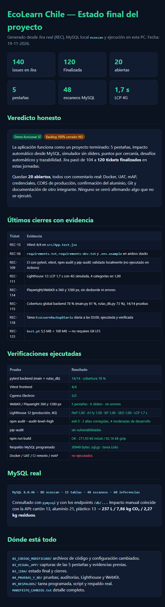

**Imagen 2 — CP-19, CP-20: menú principal y pestañas.** Fuente: `02_VISUAL_APP/01_Menu_Principal.png`.

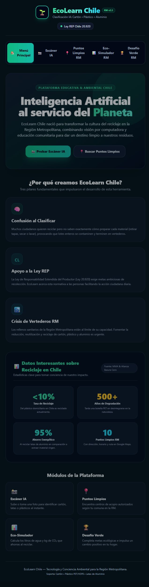

**Imagen 3 — CP-03: Escáner IA.** Fuente: `02_VISUAL_APP/02_Escanner_IA.png`.

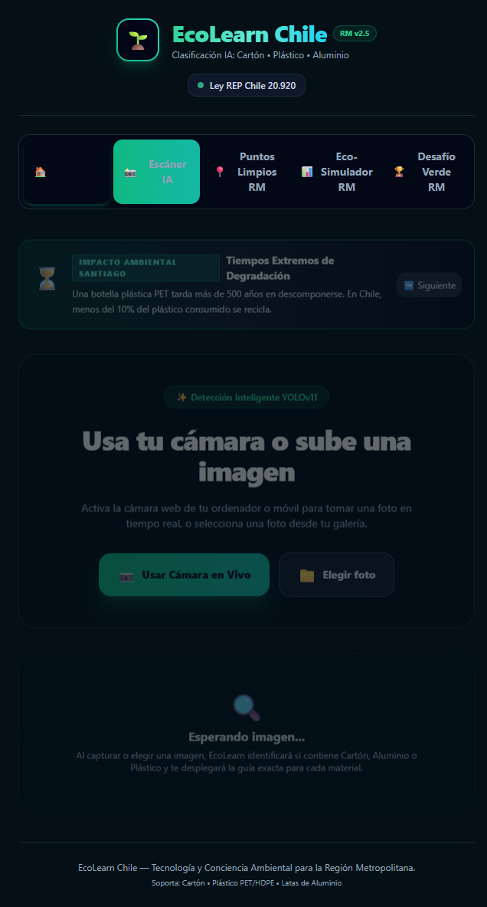

**Imagen 4 — CP-08, CP-21: Puntos Limpios y mapa.** Fuente: `02_VISUAL_APP/03_Puntos_Limpios_RM.png`.

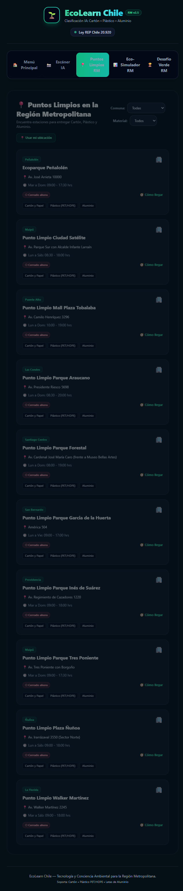

**Imagen 5 — CP-24, CP-25, CP-26: Eco-Simulador y galería.** Fuente: `02_VISUAL_APP/04_Eco_Simulador_RM.png`.

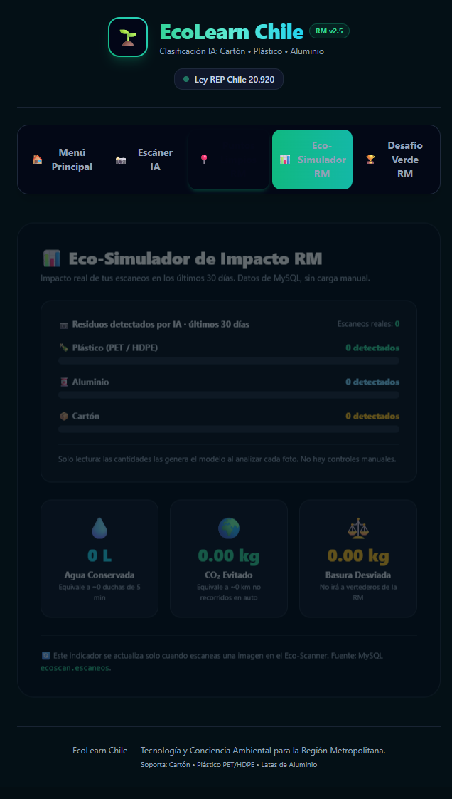

**Imagen 6 — CP-27: Desafío Verde automático.** Fuente: `02_VISUAL_APP/05_Desafio_Verde_RM.png`.

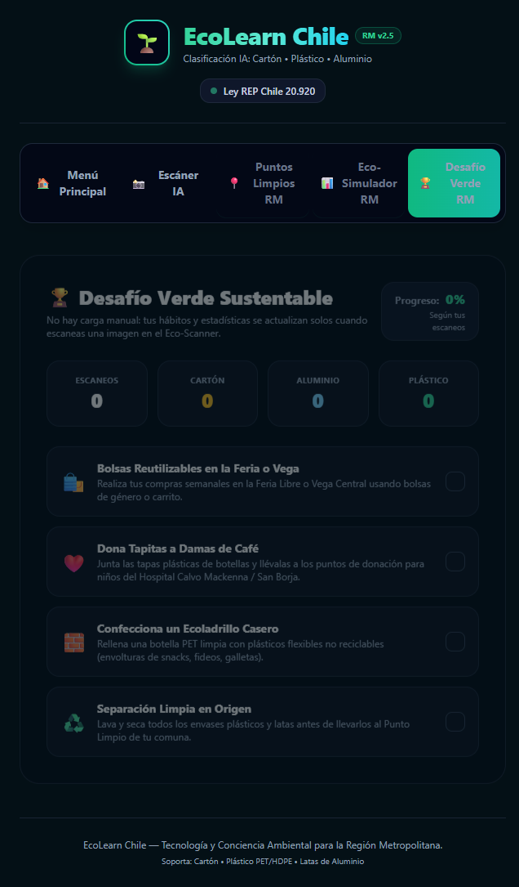

**Imagen 7 — CP-28: impacto automático desde MySQL.** Fuente: `02_VISUAL_APP/EVIDENCIA_IMPACTO_AUTOMATICO.png`.

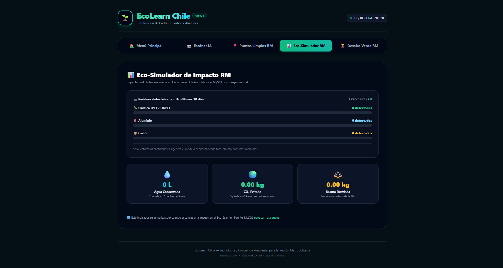

**Imagen 8 — REC-140: decisión de diseño en Jira.** Fuente: `02_VISUAL_APP/EVIDENCIA_JIRA_REC140.png`.

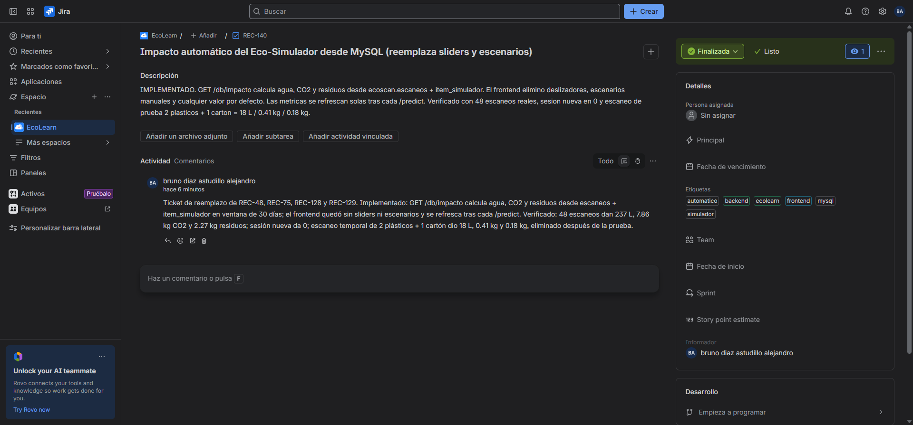

**Imagen 9 — CP-30: WebKit responsive.** Fuente: `04_PRUEBAS_Y_BD/webkit_app.png`.

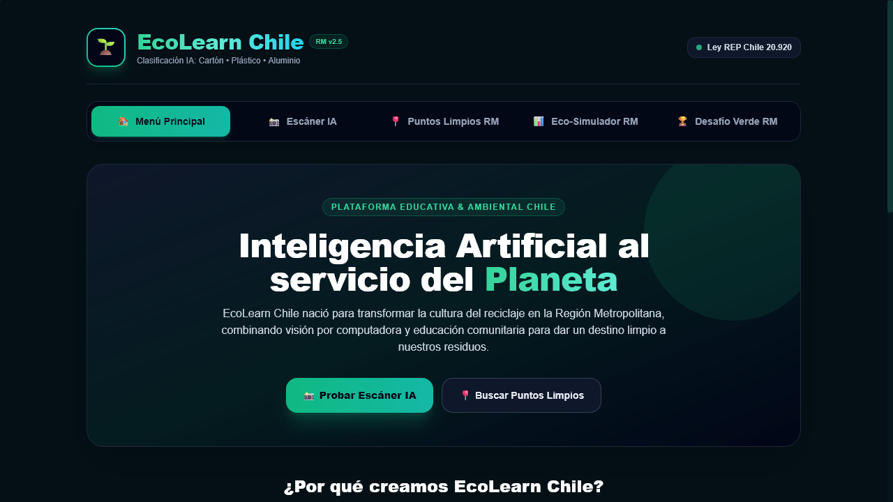

**Imagen 10 — CP-34: frontend en Docker.** Fuente: `06_DOCKER/app_en_docker_5173.jpeg`.

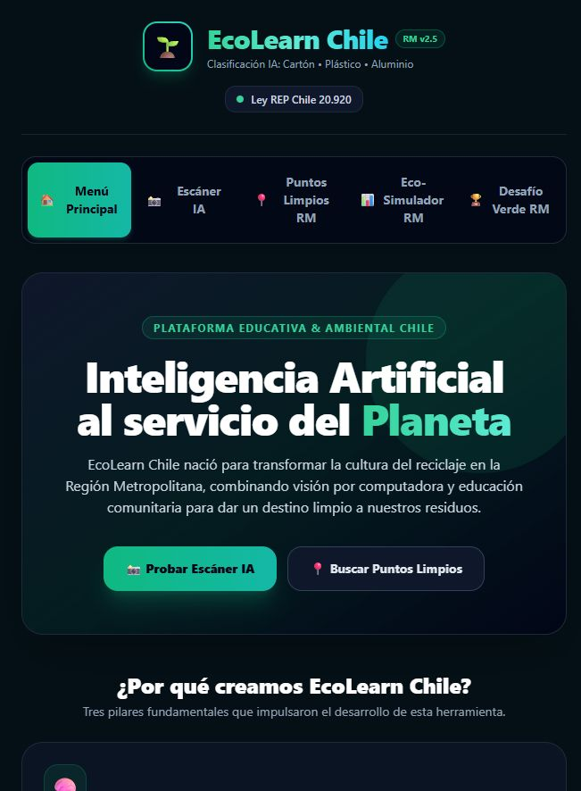

**Imagen 11 — Video de respaldo, minuto 0.** Fuente: `10_CAPTURAS_VIDEO/REC-59_00m00s_pruebas.png`.

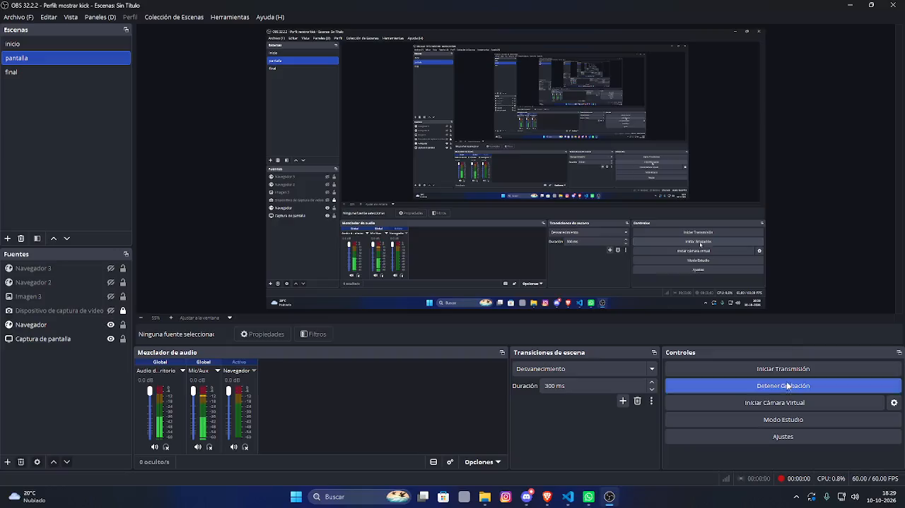

**Imagen 12 — Video de respaldo, minuto 0:30: cuatro pestañas.** Fuente: `10_CAPTURAS_VIDEO/REC-59_00m30s_cuatro_pestanas.png`.

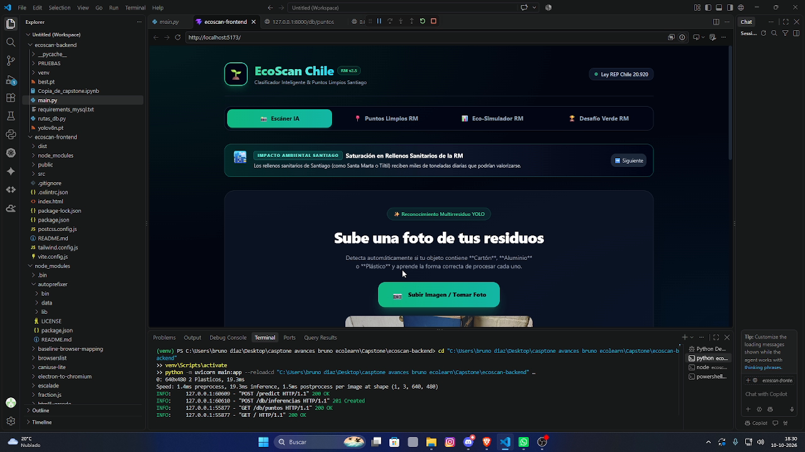

**Imagen 13 — Video de respaldo, minuto 1:15: foto y registro.** Fuente: `10_CAPTURAS_VIDEO/REC-59_01m15s_foto_y_log.png`.

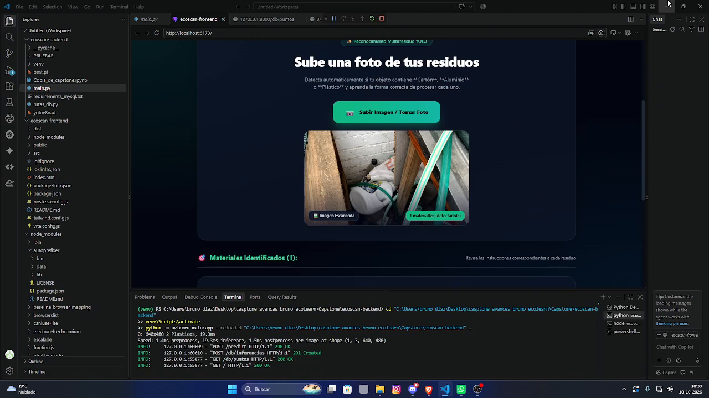

**Imagen 14 — Video de respaldo, minuto 1:50: MySQL Workbench.** Fuente: `10_CAPTURAS_VIDEO/REC-59_01m50s_mysql_workbench.png`.

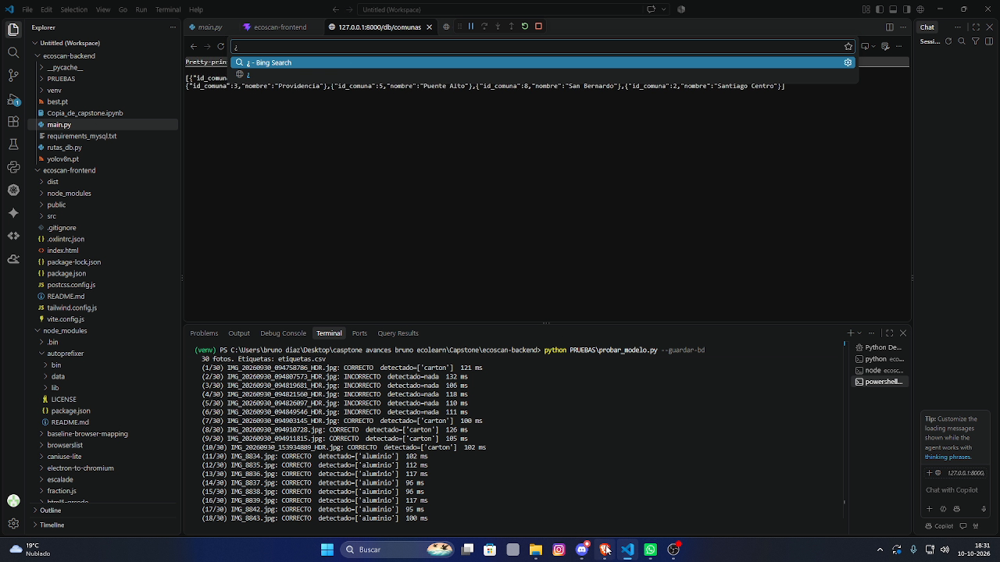

---

## 17. Aprobación

| Rol | Nombre | Fecha | Firma |
|---|---|---|---|
| Responsable de QA | Por completar | | |
| Responsable de backend | Por completar | | |
| Responsable de frontend | Por completar | | |
| Docente / evaluador | | | |

> Nota: los campos de aprobación quedan en blanco a propósito. No se inventan firmas ni nombres.
